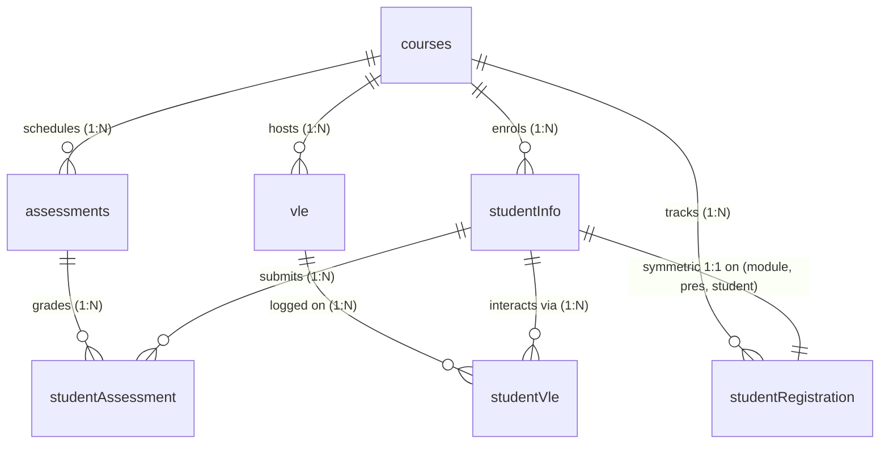

# Consolidated Dataset Research & Technical Profiling Report
## Open University Learning Analytics Dataset (OULAD)

- **Document Version:** 1.0  
- **Dataset:** Open University Learning Analytics Dataset (OULAD)  
- **Data Location:** `data/raw/`  
- **Project Scope:** Student Performance & At-Risk Prediction System  
- **Milestone:** Phase 2.8 — Consolidated Dataset Profiling & Research Report  
- **Companion Artifact:** [`reports/dataset_profile_summary.json`](file:///Users/navadeepguduru/Student%20At%20Risk%20Prediction/reports/dataset_profile_summary.json)  

---

## 1. Dataset Source, Provenance & Licensing

The **Open University Learning Analytics Dataset (OULAD)** is an internationally recognized benchmark dataset in educational data mining and learning analytics.

- **Data Owners & Institution:** The Open University, Walton Hall, Milton Keynes, MK7 6AA, United Kingdom.
- **Dataset Curators & Donors:** Jakub Kuzilek, Martin Hlosta, and Zdenek Zdrahal (Knowledge Media Institute, The Open University, UK & CIIRC, Czech Technical University in Prague).
- **Canonical Citation:** Kuzilek, J., Hlosta, M., & Zdrahal, Z. (2017). *Open University Learning Analytics dataset*. **Scientific Data**, 4, 170171. DOI: [10.1038/sdata.2017.171](https://doi.org/10.1038/sdata.2017.171).
- **Public Repository:** [https://analyse.kmi.open.ac.uk/open_dataset](https://analyse.kmi.open.ac.uk/open_dataset)
- **Licensing:** **Creative Commons Attribution 4.0 International (CC BY 4.0)**. The dataset is unrestricted for academic and commercial use with appropriate attribution.
- **Data Anonymization:** Student identifiers (`id_student`), resource identifiers (`id_site`), and assessment identifiers (`id_assessment`) are de-identified synthetic integers. Module codes are masked as three-letter codes (`AAA` through `GGG`). All dates are normalized as relative integer days from module commencement (Day 0).

---

## 2. Dataset Architecture & Macro Metrics

The dataset comprises **10,900,977 total records** partitioned across seven relational CSV tables:

| File Name | Dimensions | Storage Size | Primary / Entity Key | Foreign Keys | Logical Purpose |
| :--- | :---: | :---: | :--- | :--- | :--- |
| [`courses.csv`](file:///Users/navadeepguduru/Student%20At%20Risk%20Prediction/data/raw/courses.csv) | 22 rows × 3 cols | 526 B | `(code_module, code_presentation)` | *None* | Presentation metadata & course duration in days. |
| [`assessments.csv`](file:///Users/navadeepguduru/Student%20At%20Risk%20Prediction/data/raw/assessments.csv) | 206 rows × 6 cols | 8.0 KB | `id_assessment` | `(code_module, code_presentation)` | Assessment specifications, types, weights, and deadlines. |
| [`vle.csv`](file:///Users/navadeepguduru/Student%20At%20Risk%20Prediction/data/raw/vle.csv) | 6,364 rows × 6 cols | 264 KB | `id_site` | `(code_module, code_presentation)` | Virtual Learning Environment learning resource inventory. |
| [`studentInfo.csv`](file:///Users/navadeepguduru/Student%20At%20Risk%20Prediction/data/raw/studentInfo.csv) | 32,593 rows × 12 cols | 3.3 MB | `(code_module, code_presentation, id_student)` | `(code_module, code_presentation)` | Demographics, prior education, workload, and course outcome. |
| [`studentRegistration.csv`](file:///Users/navadeepguduru/Student%20At%20Risk%20Prediction/data/raw/studentRegistration.csv) | 32,593 rows × 5 cols | 1.1 MB | `(code_module, code_presentation, id_student)` | `(code_module, code_presentation, id_student)` | Registration dates and unregistration (withdrawal) dates. |
| [`studentAssessment.csv`](file:///Users/navadeepguduru/Student%20At%20Risk%20Prediction/data/raw/studentAssessment.csv) | 173,912 rows × 5 cols | 5.4 MB | `(id_assessment, id_student)` | `id_assessment`, `id_student` | Individual student assignment submissions and scores. |
| [`studentVle.csv`](file:///Users/navadeepguduru/Student%20At%20Risk%20Prediction/data/raw/studentVle.csv) | 10,655,280 rows × 6 cols | 433 MB | *Append-only transaction log* | `id_site`, `(code_module, code_presentation, id_student)` | High-frequency daily student-resource clickstream logs. |

---

## 3. Entity Relationships & Verified Join Topologies

### Verified Relational Truths:
1. **The Unique Enrollment Unit:** `id_student` alone is not unique. 28,785 unique students account for 32,593 enrollments (3,808 repeating or concurrent enrollments). The unique entity key is strictly:
   $$\mathbf{Enrollment\ Key} = (\text{code\_module}, \text{code\_presentation}, \text{id\_student})$$
2. **Symmetric 1-to-1 Relationship:** `studentInfo` and `studentRegistration` match identically with zero unmatched keys and zero duplicate keys across all 32,593 records.
3. **Flawless Referential Integrity:** Zero orphaned foreign keys across the entire dataset (0 unmatched course presentations, 0 unmatched assessment IDs, 0 unmatched VLE sites, and 0 unmatched student enrollments).

---

## 4. Empirical Data Quality & Missing Value Audit

### 4.1 Sentinel Encoding (`'?'`)
Raw OULAD CSV files contain **zero standard SQL nulls (`NaN`)**. All missing values are represented by the sentinel string `'?'`:

| Table | Column | Total Rows | Sentinel `'?'` Count | Missing (%) | Diagnostic Classification |
| :--- | :--- | :---: | :---: | :---: | :--- |
| `studentRegistration` | `date_unregistration` | 32,593 | 22,521 | **69.09%** | **Structurally Expected:** Student completed the course without withdrawing. |
| `vle` | `week_from` `week_to` | 6,364 | 5,243 5,243 | **82.38%** **82.38%** | **Structurally Expected:** General reference assets (forums, glossaries, URLs) available all semester. |
| `studentInfo` | `imd_band` | 32,593 | 1,111 | **3.41%** | **Administrative Constraint:** Regional postcode mapping constraint in North Region (731) and Ireland (266). |
| `studentAssessment` | `score` | 173,912 | 173 | **0.10%** | **Coursework Edge-Case:** Submitted TMAs unassigned a grade due to tutor delays or exemptions. |
| `studentRegistration` | `date_registration` | 32,593 | 45 | **0.14%** | **Administrative Edge-Case:** Provisional enrollments that withdrew immediately. |
| `assessments` | `date` | 206 | 11 | **5.34%** | **Structurally Expected:** Centrally scheduled Exams without fixed VLE submission deadlines. |

### 4.2 Duplicate Analysis
- **Six Tables:** `courses`, `assessments`, `vle`, `studentInfo`, `studentRegistration`, and `studentAssessment` contain **zero exact duplicate rows** and **zero duplicate primary keys**.
- **`studentVle.csv` (Clickstream):** Contains 787,170 exact duplicate lines (7.39%) and 2,195,949 repeated `(module, presentation, student, site, date)` tuples. These represent legitimate multiple daily sessions extracted from Moodle VLE logs and must be aggregated via `.sum()`, never discarded.

---

## 5. Statistical Profile & Exploratory Findings

### 5.1 Academic Performance
- **Score Metrics (173,739 valid submissions):** Mean: **75.80**, Median: **80.00**, Std: **18.80**, IQR: **25.00** ($Q_1=65.0, Q_3=90.0$).
- **Modality Differences:**
  - **CMA:** Mean **81.03** | Median **82.00** | Std **17.84** (Low weight, automated quizzes).
  - **TMA:** Mean **72.56** | Median **76.00** | Std **18.43** (Core graded coursework essays/projects).
  - **Exam:** Mean **65.57** | Median **67.00** | Std **20.58** (High-stakes summative exams).
- **Scores Below 50:** 15,308 submissions (**8.81%** of all scored submissions).
- **Scores Below 40 (Formal Fail):** 7,578 submissions (**4.36%** of all scored submissions).

### 5.2 Academic Outcomes & Attrition Base Rate
- **Pass:** 12,361 (37.93%) | **Distinction:** 3,024 (9.28%)
- **Withdrawn:** 10,156 (31.16%) | **Fail:** 7,052 (21.64%)
- **Aggregate At-Risk Base Rate (`Withdrawn` + `Fail`):** **52.80%** (17,208 students).
- **Curricular Variance:** Attrition peaks in Module `CCC` (44.54% Withdrawn), while examination failure peaks in Module `GGG` (28.73% Fail).

### 5.3 Registration & Withdrawal Hazards
- **Withdrawal Hazard Window:** The **median withdrawal date is Day 27**. 25% of dropouts occur before Day -2 (pre-course churn), and 75% occur by Day 109.
- **Late Registration Penalty:** Students registering after course start suffer a 41.6% higher failure rate (28.63% Fail vs. 20.22% for early registrants).

### 5.4 VLE Clickstream Dynamics
- **Total Clicks:** 39,605,099 clicks across 10,655,280 daily logs.
- **Engagement Peak:** Click volume reaches its global maximum on **Day 18 (427,217 daily clicks)** during onboarding and first assignment preparation, decaying progressively across the remaining 250 days.
- **The Inactive Cohort:** 3,365 students (10.32%) never log into the VLE; **99.9% of these inactive students withdraw or fail**.

---

## 6. Prediction Problem Formulation

### 6.1 Formal Task Definition
Our agreed predictive modeling objective is:

$$\text{Predict whether a student's next scheduled assessment score will fall below 50.}$$

$$\mathbf{Target:}\quad \text{at\_risk} = \begin{cases} 1 & \text{if } \text{score}_{\text{next}} < 50 \\ 0 & \text{if } \text{score}_{\text{next}} \ge 50 \end{cases}$$

### 6.2 Methodological Principles & Anti-Leakage Rules

1. **Future-Outcome Formulation:**
   - The prediction task is strictly prospective. For any evaluation point (cutoff time $T$), the target is the student's performance on the upcoming assessment scheduled at $T_{\text{next}} > T$.
2. **Strict Feature Prohibition (No Target Leakage):**
   - The score of the next assessment ($\text{score}_{\text{next}}$) is the prediction target and can **never** be used as an input feature.
   - Any future assessment scores ($T > T_{\text{prediction}}$) or future clickstream events are strictly inaccessible at prediction time.
3. **Absolute Exclusion of `final_result` and `date_unregistration`:**
   - `studentInfo.final_result` is an end-of-course certification code (`Distinction`, `Pass`, `Fail`, `Withdrawn`) awarded months after presentations conclude. It is **completely prohibited** as an input feature.
   - `studentRegistration.date_unregistration` reveals future dropout dates and must never be exposed to the model.
4. **Legitimate Predictive Information (Historical & Static):**
   - **Static Learner Priors:** Demographics (`age_band`, `highest_education`, `studied_credits`, `num_of_prev_attempts`, `registration_timing`).
   - **Historical Performance Trajectory:** Scores, submission lateness ($\text{date\_submitted} - \text{deadline}$), and pass rates on *prior* assessments completed before cutoff $T$.
   - **Pre-Cutoff Clickstream Dynamics:** Cumulative clicks, days active, click velocity, forum participation, and recency of last login prior to cutoff $T$.
5. **Prediction-Time Availability & Latency:**
   - In production learning management systems, tutor marking involves a publication lag (typically 7–14 days after submission). A feature pipeline must not assume assignment grades are instantly available on the submission date.

---

## 7. Risk & Limitation Register

| Risk / Limitation | Empirical Severity | Impact on Machine Learning | Mitigation Strategy |
| :--- | :---: | :--- | :--- |
| **1. Grade Publication Latency** | High | Tutor marking takes 1–2 weeks; latest TMA scores may not be available immediately after deadline. | Design cutoff features using submission timestamps and VLE clicks; treat unreleased grades as pending. |
| **2. Exam Submission Asymmetry** | High | Only modules CCC and DDD have exam submission rows (4,959 records); other courses lack exam rows. | Train continuous early-warning models on coursework (TMAs/CMAs); evaluate exam risk separately. |
| **3. Clickstream Volume Disparity** | High | Module FFF generated 17.6M clicks while Module AAA generated 1.2M clicks (14x difference). | Normalize all click features within each `(code_module, code_presentation)` cohort (z-scores / percentiles). |
| **4. Inactivity Survival Bias** | Critical | 6,750 students have 0 submissions; 3,365 have 0 clicks. Inner joins discard 80%+ dropouts. | **Mandatory LEFT JOINs** anchored on `studentInfo` with explicit zero-filling for unobserved activity. |
| **5. Class Imbalance on Scored Submissions** | Medium | Among submitted assessments, only 8.81% score $< 50$. | Optimize for Precision-Recall AUC (PR-AUC) and Recall@k rather than raw accuracy; calibrate probability thresholds. |
| **6. Repeated Student Enrollments** | Medium | 3,808 student records reflect repeat attempts or multi-module study. | Implement GroupKFold cross-validation grouped by `id_student` to prevent cross-split leakage. |
| **7. Geographic Deprivation Bias** | Low | 1,111 missing `imd_band` values concentrated in North Region (731) and Ireland (266). | Treat missing IMD band as an explicit informative category (`'Missing'`); do not drop records. |

---

## 8. Recommended Preprocessing & Ingestion Protocol for Phase 3

1. **Ingestion & Type Coercion:**
   - Load all CSV files using `na_values=['?']` to convert sentinel strings to standard `np.nan`.
   - Cast date columns (`date_registration`, `date_unregistration`, `date_submitted`, `date`) and score columns to nullable float/integer dtypes.
2. **Anchor Dataset Structure:**
   - Base modeling tables on `studentInfo` joined 1:1 with `studentRegistration` and N:1 with `courses`, preserving the exact 32,593 enrollment row grain.
3. **Two-Stage Aggregation Pipeline:**
   - Never perform row-level joins from student entities into `studentAssessment` or `studentVle`.
   - Aggregate event tables independently up to the student-presentation grain, then merge via `LEFT JOIN`.
4. **Zero-Fill Inactive Indicators:**
   - Impute missing aggregated activity metrics with 0 (e.g., `total_clicks = 0`, `tma_submitted_count = 0`), creating explicit binary flags (`is_vle_dormant = 1`).
5. **Leakage-Proof Temporal Cutoffs:**
   - Fix discrete observation horizons (e.g. Day 30, Day 60, Day 90). Filter out all clickstream logs, submissions, and status changes occurring after the horizon.

---

## 9. Conclusion & Transition to Phase 3

The foundational investigation of the Open University Learning Analytics Dataset is fully complete. All data structures, anomalies, relationships, and distributions have been empirically audited and verified. The repository is ready to advance to **Phase 3: Data Preprocessing & Feature Engineering Foundations**.

