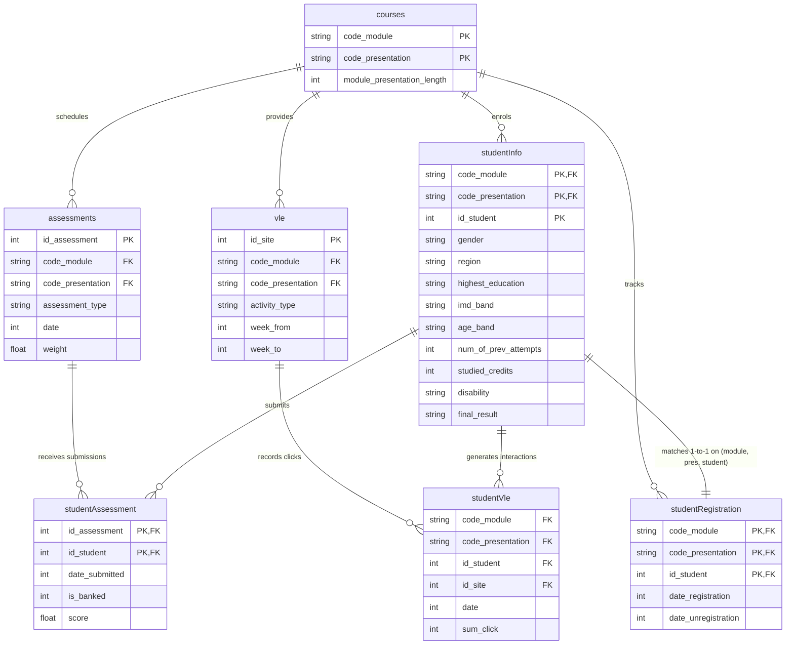

# Open University Learning Analytics Dataset (OULAD)
## Detailed Dataset Structure & Column-Level Investigation Report

- **Document Version:** 1.0  
- **Dataset Location:** `data/raw/`  
- **Analysis Scope:** All seven relational CSV files + metadata  
- **Phase:** Phase 2.4 — Dataset Structure & Column-Level Understanding  

---

## 1. Dataset Overview

The **Open University Learning Analytics Dataset (OULAD)** is an educational analytics dataset collected by The Open University (UK). It captures student demographics, module presentation schedules, assessment evaluations, registration timelines, and fine-grained Virtual Learning Environment (VLE) interaction clickstream logs.

### 1.1 High-Level Metrics
- **Total Relational Files:** 7 CSV files + 1 schema definition (`OULAD.names`)
- **Total Courses (Modules):** 7 unique modules (`AAA`, `BBB`, `CCC`, `DDD`, `EEE`, `FFF`, `GGG`)
- **Total Course Presentations:** 22 presentations (combinations of year `2013`/`2014` and intake `B` [February] / `J` [October])
- **Unique Students:** 28,785 individual learners
- **Student Enrollments:** 32,593 unique student-course-presentation records
- **Total Assessment Items:** 206 assessment components
- **Student Assessment Submissions:** 173,912 student assessment records
- **VLE Resources (Sites):** 6,364 learning materials
- **VLE Clickstream Interactions:** 10,655,280 daily student-resource interaction logs

---

## 2. File-by-File Structural Investigation

### 2.1 `courses.csv`
- **Dimensions:** 22 rows × 3 columns
- **Purpose:** Dimension table describing each module offering and its total calendar duration in days.
- **Candidate Primary Key:** Composite `(code_module, code_presentation)` (100% unique, 0 duplicates).
- **Foreign Keys:** None (Root dimension table).
- **Missing Values:** None (0% missing).

| Column Name | Raw Dtype | Inferred Type | Role | Missing Count (%) | Sample Values |
| :--- | :--- | :--- | :--- | :---: | :--- |
| `code_module` | object | Category / String | Identifier | 0 (0.0%) | `'AAA'`, `'BBB'`, `'CCC'`, `'DDD'` |
| `code_presentation` | object | Category / String | Identifier | 0 (0.0%) | `'2013J'`, `'2014J'`, `'2013B'`, `'2014B'` |
| `module_presentation_length` | int64 | Integer | Measurement (Days) | 0 (0.0%) | `268`, `269`, `240`, `262`, `241` |

**Statistical Range:**
- `module_presentation_length`: Minimum = 234 days, Maximum = 269 days, Median = 261 days.

---

### 2.2 `assessments.csv`
- **Dimensions:** 206 rows × 6 columns
- **Purpose:** Metadata on all graded assessments scheduled across each course presentation.
- **Candidate Primary Key:** `id_assessment` (100% unique, 0 duplicates).
- **Foreign Keys:** `(code_module, code_presentation)` references `courses.csv`.
- **Missing Values:** `date` has 11 missing values represented by the sentinel string `'?'` (5.34%). All 11 correspond strictly to final `Exam` assessment types.

| Column Name | Raw Dtype | Inferred Type | Role | Missing / '?' Count (%) | Unique Values | Sample Values |
| :--- | :--- | :--- | :--- | :---: | :---: | :--- |
| `code_module` | object | Category | Foreign Key | 0 (0.0%) | 7 | `'AAA'`, `'BBB'`, `'CCC'` |
| `code_presentation` | object | Category | Foreign Key | 0 (0.0%) | 4 | `'2013B'`, `'2013J'`, `'2014B'`, `'2014J'` |
| `id_assessment` | int64 | Integer | Primary Key | 0 (0.0%) | 206 | `1757`, `1758`, `1759`, `1760`, `1761` |
| `assessment_type` | object | Categorical | Category | 0 (0.0%) | 3 | `'TMA'` (106), `'CMA'` (76), `'Exam'` (24) |
| `date` | object | Integer (Nullable) | Date (Days) | 11 (5.34%) | 75 | `19`, `54`, `117`, `166`, `'?'` |
| `weight` | float64 | Float (Percentage) | Numerical | 0 (0.0%) | 24 | `10.0`, `20.0`, `100.0`, `0.0` |

**Key Assessment Characteristics:**
- **TMA (Tutor-Marked Assessment):** 106 items. Mean weight = 17.08%, Max = 35.0%.
- **CMA (Computer-Marked Assessment):** 76 items. Mean weight = 1.18%, Max = 8.0%. Many CMAs carry 0% weight (formative checkpoints).
- **Exam:** 24 items (1 per presentation + 2 duplicate exam tracks in module CCC). Weight = 100%.

---

### 2.3 `vle.csv`
- **Dimensions:** 6,364 rows × 6 columns
- **Purpose:** Inventory of all learning resources hosted on the Virtual Learning Environment.
- **Candidate Primary Key:** `id_site` (100% unique, 0 duplicates).
- **Foreign Keys:** `(code_module, code_presentation)` references `courses.csv`.
- **Missing Values:** `week_from` and `week_to` both contain 5,243 `'?'` sentinel values (82.38% unpopulated).

| Column Name | Raw Dtype | Inferred Type | Role | Missing / '?' Count (%) | Unique Values | Sample Values |
| :--- | :--- | :--- | :--- | :---: | :---: | :--- |
| `id_site` | int64 | Integer | Primary Key | 0 (0.0%) | 6,364 | `546943`, `546712`, `546777` |
| `code_module` | object | Category | Foreign Key | 0 (0.0%) | 7 | `'AAA'`, `'BBB'`, `'FFF'` |
| `code_presentation` | object | Category | Foreign Key | 0 (0.0%) | 4 | `'2013J'`, `'2014J'`, `'2013B'`, `'2014B'` |
| `activity_type` | object | Categorical | Category | 0 (0.0%) | 20 | `'resource'`, `'oucontent'`, `'forumng'`, `'url'` |
| `week_from` | object | Integer (Nullable) | Temporal Plan | 5,243 (82.38%) | 31 | `'?'`, `1`, `2`, `14`, `25` |
| `week_to` | object | Integer (Nullable) | Temporal Plan | 5,243 (82.38%) | 31 | `'?'`, `1`, `2`, `14`, `25` |

**Activity Type Distribution:**
- `resource`: 2,660 (41.8%)
- `subpage`: 1,055 (16.6%)
- `oucontent` (core textbook/content): 996 (15.6%)
- `url`: 886 (13.9%)
- `forumng` (discussion forums): 194 (3.0%)
- `quiz`: 127 (2.0%)
- `page`: 102 (1.6%)
- `oucollaborate`, `questionnaire`, `ouwiki`, `dataplus`, `externalquiz`, `homepage`, `glossary`, etc.: Remaining 5.5%.

---

### 2.4 `studentInfo.csv`
- **Dimensions:** 32,593 rows × 12 columns
- **Purpose:** Core demographic and academic outcome table at the student-enrollment level.
- **Candidate Primary Key:** Composite `(code_module, code_presentation, id_student)` (100% unique, 0 duplicates).
- *Critical Finding:* `id_student` is NOT unique alone (3,812 duplicate student IDs representing students enrolled in multiple modules or repeating presentations).
- **Foreign Keys:** `(code_module, code_presentation)` references `courses.csv`.
- **Missing Values:** `imd_band` has 1,111 missing values marked by `'?'` (3.41%).

| Column Name | Raw Dtype | Inferred Type | Role | Missing / '?' Count (%) | Unique | Sample Values |
| :--- | :--- | :--- | :--- | :---: | :---: | :--- |
| `code_module` | object | Category | Foreign Key | 0 (0.0%) | 7 | `'AAA'`, `'BBB'`, `'CCC'` |
| `code_presentation` | object | Category | Foreign Key | 0 (0.0%) | 4 | `'2013J'`, `'2014J'`, `'2013B'`, `'2014B'` |
| `id_student` | int64 | Integer | Student ID | 0 (0.0%) | 28,785 | `11391`, `28400`, `30268` |
| `gender` | object | Categorical | Demographics | 0 (0.0%) | 2 | `'M'` (17,875), `'F'` (14,718) |
| `region` | object | Categorical | Demographics | 0 (0.0%) | 13 | `'East Anglian Region'`, `'Scotland'`, `'London'` |
| `highest_education` | object | Ordinal/Cat | Prior Academic | 0 (0.0%) | 5 | `'A Level or Equivalent'` (14,045), `'Lower Than A Level'` (13,158), `'HE Qualification'` (4,730) |
| `imd_band` | object | Ordinal/Cat | Socioeconomic | 1,111 (3.41%) | 11 | `'0-10%'`, `'20-30%'`, `'80-90%'`, `'?'` |
| `age_band` | object | Ordinal/Cat | Demographics | 0 (0.0%) | 3 | `'0-35'` (22,944), `'35-55'` (9,433), `'55<='` (216) |
| `num_of_prev_attempts` | int64 | Integer | History | 0 (0.0%) | 7 | `0` (28,421), `1` (3,299), `2` (675), `3` (142), `4` (40), `5` (11), `6` (5) |
| `studied_credits` | int64 | Integer | Workload | 0 (0.0%) | 61 | `60` (10,948), `120` (8,944), `30` (3,786), `90` (2,968), Range: 30–655 |
| `disability` | object | Binary/Cat | Demographics | 0 (0.0%) | 2 | `'N'` (29,429), `'Y'` (3,164) |
| `final_result` | object | Categorical | Target Variable | 0 (0.0%) | 4 | `'Pass'` (12,361), `'Withdrawn'` (10,156), `'Fail'` (7,052), `'Distinction'` (3,024) |

---

### 2.5 `studentRegistration.csv`
- **Dimensions:** 32,593 rows × 5 columns
- **Purpose:** Enrollment timeline recording dates of course registration and potential unregistration (withdrawal).
- **Candidate Primary Key:** Composite `(code_module, code_presentation, id_student)` (100% unique, 0 duplicates). Exactly matches `studentInfo.csv`.
- **Foreign Keys:** Composite `(code_module, code_presentation, id_student)` references `studentInfo.csv`.
- **Missing Values:**
  - `date_registration`: 45 `'?'` values (0.14%).
  - `date_unregistration`: 22,521 `'?'` values (69.09%). An unregistration of `'?'` signifies the student never unregistered and remained enrolled until course conclusion.

| Column Name | Raw Dtype | Inferred Type | Role | Missing / '?' Count (%) | Summary Range / Values |
| :--- | :--- | :--- | :--- | :---: | :--- |
| `code_module` | object | Category | Foreign Key | 0 (0.0%) | 7 modules |
| `code_presentation` | object | Category | Foreign Key | 0 (0.0%) | 4 presentations |
| `id_student` | int64 | Integer | Foreign Key | 0 (0.0%) | 28,785 unique IDs |
| `date_registration` | object | Integer (Nullable) | Event Date | 45 (0.14%) | Min: -322 days, Max: +167 days, Median: -57 days |
| `date_unregistration` | object | Integer (Nullable) | Event Date | 22,521 (69.09%) | Min: -365 days, Max: +444 days, Median: +27 days |

---

### 2.6 `studentAssessment.csv`
- **Dimensions:** 173,912 rows × 5 columns
- **Purpose:** Individual assessment submission entries and grades scored by students.
- **Candidate Primary Key:** Composite `(id_assessment, id_student)` (100% unique, 0 duplicates).
- **Foreign Keys:**
  - `id_assessment` references `assessments.csv`.
  - `id_student` references `studentInfo.csv` (in conjunction with the assessment's module presentation).
- **Missing Values:** `score` has 173 `'?'` values (0.10%).

| Column Name | Raw Dtype | Inferred Type | Role | Missing / '?' Count (%) | Summary Range / Values |
| :--- | :--- | :--- | :--- | :---: | :--- |
| `id_assessment` | int64 | Integer | Foreign Key | 0 (0.0%) | 188 unique IDs (out of 206 scheduled) |
| `id_student` | int64 | Integer | Foreign Key | 0 (0.0%) | 23,369 unique students |
| `date_submitted` | int64 | Integer | Event Date (Days) | 0 (0.0%) | Min: -11 days, Max: +608 days, Median: +116 days |
| `is_banked` | int64 | Binary Flag | Academic Status | 0 (0.0%) | `0` (172,003 = 98.9%), `1` (1,909 = 1.1%) |
| `score` | object | Float (Nullable) | Numerical (0–100) | 173 (0.10%) | Min: 0, Max: 100, Mean: 75.80, Median: 80.0 |

---

### 2.7 `studentVle.csv`
- **Dimensions:** 10,655,280 rows × 6 columns
- **Purpose:** Clickstream event log recording student interactions with specific VLE materials per day.
- **Candidate Primary Key:** None (Append-only transaction log). The composite `(code_module, code_presentation, id_student, id_site, date)` contains 2,195,949 non-unique rows due to multi-session daily interactions. Requires a synthetic auto-incrementing ID if a primary key is needed.
- **Foreign Keys:**
  - `id_site` references `vle.csv`.
  - Composite `(code_module, code_presentation, id_student)` references `studentInfo.csv`.
- **Missing Values:** Exactly 0 missing or sentinel values across all 10.65 million records.

| Column Name | Raw Dtype | Inferred Type | Role | Missing / '?' Count (%) | Summary Range / Values |
| :--- | :--- | :--- | :--- | :---: | :--- |
| `code_module` | object | Category | Composite FK | 0 (0.0%) | 7 modules |
| `code_presentation` | object | Category | Composite FK | 0 (0.0%) | 4 presentations |
| `id_student` | int64 | Integer | Composite FK | 0 (0.0%) | 26,074 unique students |
| `id_site` | int64 | Integer | Foreign Key | 0 (0.0%) | 6,364 unique materials |
| `date` | int64 | Integer | Relative Day | 0 (0.0%) | Min: -25 days, Max: +269 days |
| `sum_click` | int64 | Integer | Count | 0 (0.0%) | Min: 1 click, Max: 6,977 clicks, Sum: 34,017,804 |

---

## 3. Complete Column Dictionary

| Table | Column Name | Technical Meaning & OULAD Context | Category Type | Academic Predictive Utility |
| :--- | :--- | :--- | :--- | :--- |
| `courses` | `code_module` | 3-letter module code identifier (AAA to GGG). | Identifier | Module domain (STEM vs Social Sciences) baseline difficulty. |
| `courses` | `code_presentation` | Year and semester code (`B`=Feb, `J`=Oct). | Identifier | Seasonal intake differences in retention and student profiles. |
| `courses` | `module_presentation_length` | Total scheduled length of course in days. | Numerical (Days) | Normalizes temporal cutoff days (e.g. Day 30 of 240 vs 269). |
| `assessments` | `id_assessment` | Unique numeric identifier for the assessment. | Identifier | Links grades and deadlines to student submissions. |
| `assessments` | `assessment_type` | Evaluation modality: TMA, CMA, or Exam. | Categorical | TMA measures deep work; CMA measures continuous mastery. |
| `assessments` | `date` | Final scheduled submission deadline (days from start). | Date (Days) | Critical reference point for calculating submission lateness. |
| `assessments` | `weight` | Contribution percentage of this assessment toward final grade. | Numerical (%) | Computes weighted average grades to date. |
| `vle` | `id_site` | Unique numeric identifier for a VLE learning resource. | Identifier | Maps clickstream interactions to material types. |
| `vle` | `activity_type` | Nature of resource (forum, oucontent, quiz, url, etc.). | Categorical | Distinguishes passive reading vs active engagement vs social forum. |
| `vle` | `week_from` | Planned start week for student engagement with material. | Temporal Plan | Compares actual interaction time against planned syllabus pacing. |
| `vle` | `week_to` | Planned end week for student engagement with material. | Temporal Plan | Measures whether student fell behind planned curriculum schedule. |
| `studentInfo` | `id_student` | Unique numeric identifier for an individual learner. | Identifier | Cross-presentation student tracking and history modeling. |
| `studentInfo` | `gender` | Student's reported sex (M/F). | Demographics | Fairness, demographic equity audit, and demographic profiling. |
| `studentInfo` | `region` | Geographic location of student residence. | Demographics | Regional disparity and infrastructure/access analysis. |
| `studentInfo` | `highest_education` | Highest educational qualification attained prior to entry. | Ordinal | Strong prior indicator of academic readiness and foundational skill. |
| `studentInfo` | `imd_band` | Index of Multiple Deprivation decile band (socioeconomic proxy). | Ordinal | Socioeconomic disadvantage indicator; equity risk analysis. |
| `studentInfo` | `age_band` | Student age categorized into 0–35, 35–55, 55<=. | Ordinal | Mature student status; balancing adult work/study commitments. |
| `studentInfo` | `num_of_prev_attempts` | Prior attempts at this specific module (0 to 6). | Numerical (Count) | Repeat-attempt penalty; prior struggle increases dropout risk. |
| `studentInfo` | `studied_credits` | Total credit load currently studied across all modules. | Numerical (Credits) | Cognitive overload / academic workload stress indicator. |
| `studentInfo` | `disability` | Self-declared disability status (Y/N). | Categorical | Equity monitoring; specialized learning support flag. |
| `studentInfo` | `final_result` | Final course outcome: Distinction, Pass, Fail, Withdrawn. | Target Outcome | Ground-truth label for predictive classification. |
| `studentRegistration` | `date_registration` | Days relative to course start student enrolled (negative = early). | Date (Days) | Late registration is a documented early-warning churn risk. |
| `studentRegistration` | `date_unregistration` | Days relative to course start student withdrew. | Date (Days) | Pinpoints exact timing of dropout events for survival modeling. |
| `studentAssessment` | `date_submitted` | Actual submission day relative to course start. | Date (Days) | Lateness = `date_submitted - scheduled_date`. |
| `studentAssessment` | `is_banked` | Result carried over from previous presentation (1=Yes, 0=No). | Binary Flag | Identifies students repeating who preserved prior assignment credit. |
| `studentAssessment` | `score` | Score awarded on assignment (scale 0–100; <40 = Fail). | Numerical (Score) | Primary performance metric; trending trajectory of scores. |
| `studentVle` | `date` | Calendar day of VLE interaction relative to start (-25 to 269). | Date (Days) | Temporal feature calculation (recency, frequency, velocity). |
| `studentVle` | `sum_click` | Total click count on given resource on given date. | Numerical (Count) | High-resolution intensity of engagement and study persistence. |

---

## 4. Table Relationships & Entity-Relationship Architecture

### 4.1 Relationship Integrity Audit
1. **`studentInfo ↔ studentRegistration`**:
   - **Key:** Composite `(code_module, code_presentation, id_student)`.
   - **Check:** Exactly 32,593 rows in both tables. Perfect 1-to-1 match. 0 orphans on either side.
2. **`studentInfo ↔ courses`**:
   - **Key:** `(code_module, code_presentation)`.
   - **Check:** All 32,593 enrollment rows cleanly map to the 22 module presentations in `courses.csv`. 0 orphans.
3. **`studentAssessment ↔ assessments`**:
   - **Key:** `id_assessment`.
   - **Check:** All 173,912 submissions reference valid `id_assessment` entries in `assessments.csv`. 18 assessments in `assessments.csv` (11 final exams and 7 CMAs) have 0 student submissions recorded.
4. **`studentAssessment ↔ studentInfo`**:
   - **Key:** Resolving `id_assessment` to its `(code_module, code_presentation)` shows that 100% of the `(code_module, code_presentation, id_student)` triplets exist in `studentInfo.csv`. 0 orphaned submissions.
5. **`studentVle ↔ vle`**:
   - **Key:** `id_site`.
   - **Check:** Across all 10,655,280 clickstream records, exactly 0 unmatched `id_site` entries exist. All sites map to `vle.csv`.
6. **`studentVle ↔ studentInfo`**:
   - **Key:** Composite `(code_module, code_presentation, id_student)`.
   - **Check:** 0 orphaned clickstream records. Every single clickstream log maps to a registered student in `studentInfo.csv`.

---

## 5. Important Conceptual Distinctions

### 5.1 Assessment Scheduled Date vs. Submission Date
- **Scheduled Date (`assessments.date`):** The institutional deadline established in the course syllabus (e.g. Day 54).
- **Submission Date (`studentAssessment.date_submitted`):** The actual day the student submitted their work (e.g. Day 58).
- **Analytical Difference:** The delta (`date_submitted - scheduled_date`) represents submission timeliness / lateness. Consistently submitting near or after deadlines is a proven behavioral symptom of academic distress.

### 5.2 Assessment Score vs. `final_result`
- **Assessment Score (`studentAssessment.score`):** Continuous numeric grade (0–100) received on a single granular assessment.
- **Final Result (`studentInfo.final_result`):** High-level academic classification at course completion (`Distinction`, `Pass`, `Fail`, `Withdrawn`).
- **Analytical Difference:** An individual low score does not guarantee course failure, but a downward trajectory in assessment scores signals imminent risk of failure or withdrawal.

### 5.3 Course Module vs. Course Presentation
- **Module (`code_module`):** The curriculum subject or course itself (e.g., `AAA` = Social Science, `BBB` = STEM/Business).
- **Presentation (`code_presentation`):** The specific temporal cohort/semester iteration (e.g., `2013J` = October 2013 intake, `2014B` = February 2014 intake).
- **Analytical Difference:** A student can take module `AAA` multiple times across different presentations. Therefore, analysis must always group by the presentation level.

### 5.4 VLE Resource vs. Student VLE Interaction
- **VLE Resource (`vle.csv`):** Static educational asset cataloged by instructors (e.g., a PDF document, quiz page, or forum board).
- **Student VLE Interaction (`studentVle.csv`):** Dynamic behavioural transaction generated when a learner accesses a resource on a specific date.
- **Analytical Difference:** Resource properties define *what* is available; interaction logs capture *how, when, and how frequently* learners actively engage.

### 5.5 Registration Date vs. Unregistration Date
- **Registration Date (`date_registration`):** Day the student officially signed up for the course. Negative values indicate early enrollment prior to course start (e.g., `-57` days).
- **Unregistration Date (`date_unregistration`):** Day the student officially withdrew from the course. Populated if and only if the student dropped out (with 93 exceptions who unofficially withdrew).
- **Analytical Difference:** Late registration indicates rushed enrollment, while unregistration marks the exact termination of student tenure for survival/hazard modeling.

### 5.6 TMA, CMA, and Exam Assessment Modalities
- **TMA (Tutor-Marked Assessment):** Written essays, lab reports, or problem sets graded manually by tutors. Carries substantial weight (average 17%) and measures deep conceptual understanding.
- **CMA (Computer-Marked Assessment):** Automated multiple-choice questions or online quizzes. Frequently formative with low or zero weight (average 1.2%), serving as self-testing milestones.
- **Exam:** Comprehensive final summative examination. Carries 100% of the exam component weight.

---

## 6. Key Data-Quality Concerns & Limitations

### 6.1 Sentinel Representation of Null Values (`'?'`)
Rather than standard SQL `NULL` or empty strings, missing values in several OULAD tables are encoded as `'?'`. 
- `studentRegistration.date_unregistration`: 22,521 rows (69.09%) are `'?'`.
- `vle.week_from` / `week_to`: 5,243 rows (82.38%) are `'?'`.
- `studentInfo.imd_band`: 1,111 rows (3.41%) are `'?'`.
- `studentAssessment.score`: 173 rows (0.10%) are `'?'`.
- `assessments.date`: 11 rows (5.34%) are `'?'`.

### 6.2 Exam Data Asymmetry Across Modules
Exam submission records are recorded in `studentAssessment.csv` **only for modules CCC and DDD** (4,959 records). For modules AAA, BBB, EEE, FFF, and GGG, exam marks are not captured in the submission table; their impact is integrated directly into the `final_result` column in `studentInfo.csv`. Predictive models must rely primarily on continuous coursework (TMAs and CMAs) rather than final exams.

### 6.3 Temporal Data Leakage Risk in Early-Warning Modeling
`final_result` and `date_unregistration` occur at the end of or during the semester. Any early-warning model must strictly adhere to temporal cut-offs (e.g. Day 30, Day 60, Day 90) and filter out all clickstream logs, submission records, and withdrawal signals occurring after the cutoff threshold.

---

## 7. Next Steps for Phase 3 (Exploratory Data Analysis)
1. **Clean Type Casting:** Coerce string `'?'` sentinels to `np.nan` and cast numeric/date columns to proper nullable integer/float representations.
2. **Univariate Profiling:** Inspect distributions of student demographics (`gender`, `highest_education`, `imd_band`, `age_band`) across course outcomes.
3. **Temporal Engagement Aggregation:** Aggregate daily clickstream counts per student across critical early-semester milestones.

