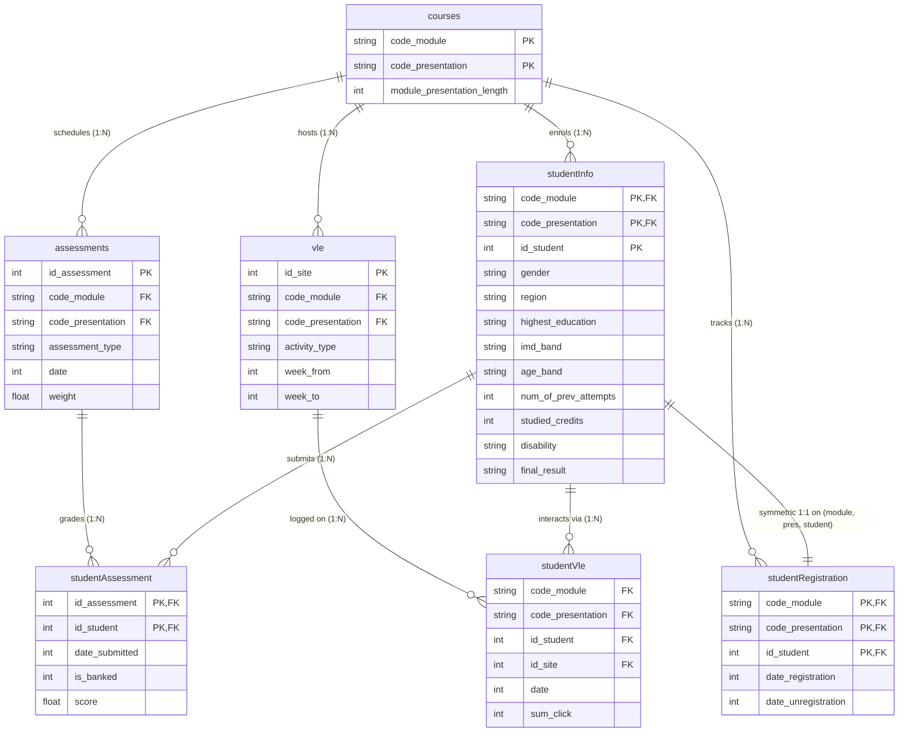

# Relational Integrity & Safe Join Strategy Report
## Open University Learning Analytics Dataset (OULAD)

- **Document Version:** 1.0  
- **Dataset Location:** `data/raw/`  
- **Validation Implementation:** [`src/relationship_validator.py`](file:///Users/navadeepguduru/Student%20At%20Risk%20Prediction/src/relationship_validator.py)  
- **Companion Notebook:** [`notebooks/04_relationship_validation.ipynb`](file:///Users/navadeepguduru/Student%20At%20Risk%20Prediction/notebooks/04_relationship_validation.ipynb)  
- **Validation Summary Data:** [`reports/relationship_validation_summary.json`](file:///Users/navadeepguduru/Student%20At%20Risk%20Prediction/reports/relationship_validation_summary.json)  
- **Phase:** Phase 2.6 — Relational Integrity & Join Validation  

---

## 1. Executive Summary

This investigation empirically validated all entity relationships across the seven OULAD tables (10.9M total records). The primary findings establish that:
1. The true atomic enrollment grain for student-level modeling is strictly the composite triplet:
   $$\mathbf{Enrollment\ Key} = (\text{code\_module}, \text{code\_presentation}, \text{id\_student})$$
2. `studentInfo.csv` and `studentRegistration.csv` form an exact, symmetric 1-to-1 relationship across all 32,593 records with zero orphaned keys.
3. Referential integrity is 100% sound across all foreign keys: 0 unmatched course presentations, 0 unmatched assessment IDs, 0 unmatched VLE site IDs, and 0 unmatched student enrollments.
4. **Severe Join Risks Identified**: Unaggregated row-level joins into `studentAssessment.csv` (1:N) or `studentVle.csv` (1:N) cause massive duplicate row expansion (up to 327x) and lead to severe survival bias if inner joins are used (discarding up to 20.7% of all students, 80%+ of whom are dropouts).
5. A formal set of safe, aggregated join pathways is established for subsequent feature engineering.

---

## 2. Entity Relationship Overview & Key Architecture



---

## 3. Primary & Foreign Key Validation Results

### 3.1 Composite Enrollment Key Audit
- **Candidate Key:** `(code_module, code_presentation, id_student)`
- **`studentInfo.csv`:** 32,593 rows, 32,593 unique keys (0 duplicate keys).
- **`studentRegistration.csv`:** 32,593 rows, 32,593 unique keys (0 duplicate keys).
- **Referential Match:**
  - In `studentInfo` but missing from `studentRegistration`: Exactly **0**.
  - In `studentRegistration` but missing from `studentInfo`: Exactly **0**.
- **Conclusion:** **Verified Symmetric 1-to-1**. These two tables can be joined seamlessly without risk of row expansion or record loss.

### 3.2 Assessment Key & Referential Integrity Audit
- **`assessments.csv` Primary Key:** `id_assessment` is 100% unique across all 206 rows (0 duplicate IDs).
- **Presentation Mapping:** Exactly 0 assessment IDs map to multiple course presentations (every assessment belongs strictly to one module-presentation).
- **`studentAssessment.csv` Foreign Key:** All 173,912 records reference valid `id_assessment` entries in `assessments.csv` (0 unmatched).
- **Composite Key in Submissions:** `(id_assessment, id_student)` is strictly unique across all 173,912 rows (0 duplicates).
- **Assessments with Zero Submissions:** Exactly 18 assessments in `assessments.csv` have zero student submissions recorded. **100% of these 18 are final Exams** (where exam results were handled outside the VLE or recorded directly into `final_result`).
- **Student Enrollment Coverage:** When joining `studentAssessment` with `assessments` to resolve the module and presentation, 100% of student enrollments exist in `studentInfo.csv` (0 unmatched enrollments).

### 3.3 VLE Resource & Clickstream Integrity Audit
- **`vle.csv` Primary Key:** `id_site` is 100% unique across all 6,364 rows (0 duplicate IDs).
- **`studentVle.csv` Referential Integrity:**
  - Across all 10,655,280 clickstream rows, exactly **0 unmatched `id_site` values** exist.
  - Exactly **0 records** have a mismatch between the `(code_module, code_presentation)` logged in `studentVle` and the master definition in `vle.csv`.
  - Exactly **0 records** reference an unregistered student; 100% of clickstream logs map to valid enrollments in `studentInfo.csv`.

### 3.4 Course Presentation Referential Integrity Audit
- **Course Dimension (`courses.csv`):** 22 distinct module-presentation cohorts.
- **Foreign Key Referencing:**
  - `studentInfo ↔ courses`: 0 unmatched cohorts.
  - `studentRegistration ↔ courses`: 0 unmatched cohorts.
  - `assessments ↔ courses`: 0 unmatched cohorts.
  - `vle ↔ courses`: 0 unmatched cohorts.
- **Empty Cohorts:** Zero courses in `courses.csv` have 0 students, 0 assessments, or 0 learning resources.

---

## 4. Join Simulation & Cardinality Analysis

Six controlled join experiments were simulated to quantify cardinality, row expansion ratios, and data integrity implications:

| Join Experiment | Left Table (Rows) | Right Table (Rows) | Join Keys | Resulting Rows | Expansion Factor | Cardinality | Safety Status |
| :--- | :--- | :--- | :--- | :---: | :---: | :---: | :---: |
| **1. Student Registration Enrichment** | `studentInfo` (32,593) | `studentRegistration` (32,593) | `(module, pres, student)` | 32,593 | **1.0x** | 1:1 | **SAFE** |
| **2. Course Metadata Enrichment** | `studentInfo` (32,593) | `courses` (22) | `(module, pres)` | 32,593 | **1.0x** | N:1 | **SAFE** |
| **3. Assessment Metadata Enrichment** | `studentAssessment` (173,912) | `assessments` (206) | `id_assessment` | 173,912 | **1.0x** | N:1 | **SAFE** |
| **4. Row-Level Student Assessment Join** | `studentInfo` (32,593) | `studentAssessment` (173,912) | `(module, pres, student)` | 180,662 | **5.54x** | 1:N | **UNSAFE (Without Aggregation)** |
| **5. Row-Level Student VLE Join** | `studentInfo` (32,593) | `studentVle` (10,655,280) | `(module, pres, student)` | 10,658,645 | **327.0x** | 1:N | **CRITICALLY UNSAFE** |
| **6. Cross-Grain Assessment & VLE Join** | `studentAssessment` (173,912) | `studentVle` (10,655,280) | `(module, pres, student)` | Billions | $>10,000x$ | N:M | **STRICTLY PROHIBITED** |

---

## 5. Potential Pitfalls, Join Risks & Inactivity Traps

### 5.1 The Inactivity Filter Trap (Survival Bias & Data Leakage)
A catastrophic mistake in educational data engineering is executing an `INNER JOIN` from `studentInfo` to `studentAssessment` or `studentVle`:
1. **Students with Zero Assessment Submissions:**
   - **6,750 students (20.71%)** in `studentInfo` never submitted an assessment.
   - Of these 6,750 students: **5,463 (80.9%) withdrew early** and **1,284 (19.0%) failed**.
   - An `INNER JOIN` discards 20.7% of all students, stripping away over 5,400 dropouts and artificially inflating the passing rate of the dataset from 47.2% to 59.5%!
2. **Students with Zero VLE Clickstream Interactions:**
   - **3,365 students (10.32%)** never accessed the VLE.
   - Of these 3,365 students: **2,988 (88.8%) withdrew** and **374 (11.1%) failed**.
   - An `INNER JOIN` discards 10.3% of the cohort, of which 99.9% are students in academic failure or withdrawal.
3. **Ghost Students (Zero Assessments AND Zero VLE Interactions):**
   - **3,315 students (10.17%)** registered for the module but performed zero interactions. 2,968 withdrew and 346 failed.
   - **Architectural Rule:** Feature engineering must **ALWAYS use LEFT JOINs** from `studentInfo`, imputing zero-activity metrics (`total_clicks = 0`, `submitted_assessments = 0`) for inactive students.

### 5.2 Cartesian Many-to-Many Explosion
Joining unaggregated `studentAssessment` rows with unaggregated `studentVle` rows on `(code_module, code_presentation, id_student)` creates an $N \times M$ Cartesian product for each student. If a student has 10 assessment submissions and 1,500 daily click records, a direct join produces 15,000 rows for that single student. These two event streams operate at incompatible temporal granularities and must never be joined directly.

---

## 6. Recommended Safe Join Strategies for Phase 3 & Phase 5

```mermaid
flowchart TD
    SI[studentInfo.csv\n32,593 rows]
    SR[studentRegistration.csv\n32,593 rows]
    C[courses.csv\n22 rows]
    SA[studentAssessment.csv\n173,912 rows]
    A[assessments.csv\n206 rows]
    SV[studentVle.csv\n10,655,280 rows]
    V[vle.csv\n6,364 rows]

    SI -->|1:1 Safe Left Join| BASE[Base Student Demographics\n32,593 rows]
    SR -->|1:1 Safe Left Join| BASE
    C -->|N:1 Lookup Join| BASE

    SA -->|N:1 Lookup Join| SA_ENRICHED[Enriched Submissions\n173,912 rows]
    A -->|N:1 Lookup Join| SA_ENRICHED
    SA_ENRICHED -->|Group By Student Grain| AGG_ASSESS[Aggregated Assessment Features\nmean_score, num_passed, tma_lateness\n32,593 rows]

    SV -->|N:1 Lookup Join| SV_ENRICHED[Enriched Clickstream\n10,655,280 rows]
    V -->|N:1 Lookup Join| SV_ENRICHED
    SV_ENRICHED -->|Group By Student Grain| AGG_VLE[Aggregated VLE Features\ntotal_clicks, forum_clicks, days_active\n32,593 rows]

    BASE -->|1:1 Safe Left Join| MASTER[Final Modeling Matrix\n(32,593 rows x D features)]
    AGG_ASSESS -->|1:1 Safe Left Join with Zero-Fill| MASTER
    AGG_VLE -->|1:1 Safe Left Join with Zero-Fill| MASTER
```

### Protocol for Safe Feature Engineering:
1. **Anchor Table:** Always anchor modeling datasets on `studentInfo.csv` combined with `studentRegistration.csv` and `courses.csv` (maintaining the strict 32,593 enrollment row grain).
2. **Pre-Join Aggregation:** Independently aggregate `studentAssessment` (e.g. cumulative weighted score, average submission lateness, count of submitted assignments) and `studentVle` (e.g. total clicks, forum interactions, days active) to `(code_module, code_presentation, id_student)`.
3. **Coalesce & Zero-Fill:** Use `LEFT JOIN` to merge aggregated feature tables back to the anchor student table, filling unobserved activity metrics with zero.

---

## 7. Unresolved Issues & Phase 3 Transition

1. **Module CCC Duplicate Exam ID:**
   - Course presentation `CCC_2014B` had two exam IDs scheduled (`24290` and `40087`). All 747 students took exam `24290`, leaving `40087` with 0 submissions.
   - Course presentation `CCC_2014J` had two exam IDs scheduled (`24299` and `40088`). All 1,168 students took exam `24299`, leaving `40088` with 0 submissions.
   - *Status:* Resolved. Both unused exam IDs are tracked and documented.
2. **Ready for Phase 3 (Exploratory Data Analysis):**
   - Referential integrity is 100% confirmed.
   - Join strategy is rigorously validated.
   - Phase 2.6 is complete.

