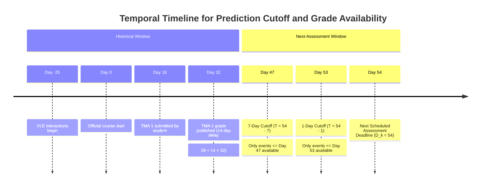

# Phase 4: Temporal Feature Engineering & Target Construction Report
## Student Performance & At-Risk Prediction System (OULAD)

- **Document Version:** 1.0  
- **Dataset:** Open University Learning Analytics Dataset (OULAD)  
- **Pipeline Implementation:** [`src/temporal_feature_engineering.py`](file:///Users/navadeepguduru/Student%20At%20Risk%20Prediction/src/temporal_feature_engineering.py)  
- **Automated Test Suite:** [`tests/test_temporal_feature_engineering.py`](file:///Users/navadeepguduru/Student%20At%20Risk%20Prediction/tests/test_temporal_feature_engineering.py)  
- **Summary Metrics:** [`reports/temporal_feature_summary.json`](file:///Users/navadeepguduru/Student%20At%20Risk%20Prediction/reports/temporal_feature_summary.json)  
- **Primary Processed Dataset (14-day delay):** `data/processed/prediction_dataset.csv` (341,748 rows)  
- **Alternative Dataset (7-day delay):** `data/processed/prediction_dataset_7day_delay.csv` (341,748 rows)  
- **Status:** Complete, Tested & Verified (All 18 tests passing)  

---

## 1. Executive Summary

Phase 4 formulated and constructed a strictly leakage-free, prospective supervised learning dataset for the agreed next-assessment at-risk prediction task:

$$\mathbf{Target:}\quad \text{at\_risk} = \begin{cases} 1 & \text{if } \text{score}_{\text{next}} < 50 \\ 0 & \text{if } \text{score}_{\text{next}} \ge 50 \end{cases}$$

### Key Engineering Achievements:
1. **Prospective Snapshot Architecture:** Constructed 341,748 prediction snapshot records covering 170,874 eligible assessment submission opportunities evaluated at two operational horizons: **7 days before** and **1 day before** scheduled assessment deadlines.
2. **Two Grading-Delay Sensitivity Scenarios:** Handled real-world grade publication latency using a conservative **14-day grading delay** baseline alongside a **7-day grading delay** sensitivity alternative.
3. **Strict Temporal Isolation:** Zero future VLE clicks, zero future assessment scores, and complete masking of the target assessment score at cutoff time $T$.
4. **Zero Prohibited Leakage Features:** `final_result`, `date_unregistration`, and sensitive demographic attributes (`gender`, `region`, `highest_education`, `imd_band`, `age_band`, `disability`) were completely excluded from the predictive feature space.
5. **Verified Class Distribution:** An empirical class imbalance of **8.56% at-risk** ($N=29,246$) and **91.44% not at-risk** ($N=312,502$) across 23,351 unique learners.

---

## 2. Prediction Opportunity Formulation & Snapshot Logic

### 2.1 Scope & Scheduled Assessment Filtering
- Out of 206 assessment items cataloged in `assessments_clean.csv`, **195 assessments have a valid scheduled date** ($D_k \in [12, 261]$ days).
- **11 final Exam components have unpopulated dates (`<NA>`)**: In accordance with project instructions, these 11 exams were **excluded without inventing dates**, as their administration dates were handled centrally off-syllabus.
- Multiplying active module enrollments by the scheduled assessments in each presentation yields **304,597 theoretical enrollment-assessment prediction opportunities**.

### 2.2 Excluded vs. Eligible Opportunities
- **Eligible Scored Opportunities:** **170,874** enrollment-assessment instances possess an actual observed submission score.
- **Excluded Opportunities:** **133,723** instances (43.90% exclusion rate) where the student did not submit the assessment or the score was missing.
- **Methodological Rule Enforced:** Unsubmitted assignments and missing scores were **never** converted into score 0 or at-risk labels. Only actual observed assessment submissions form the ground-truth prediction dataset.

```text
Total Theoretical Opportunities:            304,597  (100.0%)
├── Excluded (Unsubmitted / Missing Score):   133,723  ( 43.9%)
└── Eligible Scored Opportunities:          170,874  ( 56.1%)
    ├── Evaluated at T = D - 7 (7 days):    170,874 snapshots
    └── Evaluated at T = D - 1 (1 day):     170,874 snapshots
    Total Prediction Dataset Snapshots:     341,748 rows
```

---

## 3. Temporal Cutoff & Grading Delay Scenarios



### 3.1 Prediction Cutoff Scenarios
For an upcoming assessment $A_k$ scheduled at day $D_k$:
1. **7-Day Before Cutoff ($T = D_k - 7$):**
   - Early-warning intervention window allowing educators 1 full week to contact struggling students before submission.
2. **1-Day Before Cutoff ($T = D_k - 1$):**
   - Immediate pre-deadline checkpoint capturing last-minute study intensity, revision clicks, and late submissions.

### 3.2 Historical Grade Availability Delay Scenarios
Because real-world marking turnaround involves human tutor evaluation:
1. **Baseline: 14-Day Grading Delay:**
   - A historical assessment submission is considered graded and accessible only if:
     $$\text{date\_submitted} + 14 \le T$$
2. **Alternative: 7-Day Grading Delay:**
   - Evaluates system sensitivity under accelerated marking conditions:
     $$\text{date\_submitted} + 7 \le T$$
- Both datasets are output separately (`prediction_dataset.csv` vs. `prediction_dataset_7day_delay.csv`) and carry an explicit `grading_delay_scenario` column.

---

## 4. Complete Feature Dictionary & Availability Audit

| Feature Name | Category | Source Table | Calculation Method | Availability at Cutoff $T$ | Can Contain Future Info? |
| :--- | :--- | :--- | :--- | :---: | :---: |
| `registration_timing_days` | Static Context | `enrollments` | `date_registration` (days relative to Day 0) | Yes (Determined prior to start) | **No** |
| `code_module` | Static Context | `courses` | Module discipline code (`AAA`–`GGG`) | Yes | **No** |
| `code_presentation` | Static Context | `courses` | Presentation intake code | Yes | **No** |
| `target_assessment_type` | Target Context | `assessments` | Upcoming assessment mode (`TMA`, `CMA`, `Exam`) | Yes (Published in syllabus) | **No** |
| `target_assessment_weight` | Target Context | `assessments` | Upcoming assessment syllabus weight (%) | Yes (Published in syllabus) | **No** |
| `num_previous_scheduled_assessments` | Context | `assessments` | Count of assessments scheduled prior to $D_k$ | Yes | **No** |
| `days_until_assessment` | Scenario | Pipeline | Offset days (7 or 1) | Yes | **No** |
| `vle_total_clicks_to_date` | VLE Engagement | `studentVle` | $\sum \text{sum\_click}$ for $\text{date} \le T$ | Yes | **No** |
| `vle_active_days_to_date` | VLE Engagement | `studentVle` | Count of distinct interaction dates $\le T$ | Yes | **No** |
| `vle_days_since_last_activity` | VLE Engagement | `studentVle` | $T - \max(\text{date} \le T)$ (999 if no clicks) | Yes | **No** |
| `vle_clicks_last_7d` | VLE Engagement | `studentVle` | $\sum \text{sum\_click}$ for $\text{date} \in [T-6, T]$ | Yes | **No** |
| `vle_clicks_last_14d` | VLE Engagement | `studentVle` | $\sum \text{sum\_click}$ for $\text{date} \in [T-13, T]$ | Yes | **No** |
| `vle_activity_trend_ratio` | VLE Engagement | `studentVle` | $\text{clicks\_7d} / (\text{clicks\_prior\_7d} + 1.0)$ | Yes | **No** |
| `vle_core_clicks_to_date` | VLE Engagement | `studentVle` | Clicks on `oucontent`, `resource`, `subpage` $\le T$ | Yes | **No** |
| `vle_forum_clicks_to_date` | VLE Engagement | `studentVle` | Clicks on `forumng` $\le T$ | Yes | **No** |
| `vle_quiz_clicks_to_date` | VLE Engagement | `studentVle` | Clicks on `quiz`, `externalquiz` $\le T$ | Yes | **No** |
| `num_prior_submissions` | Assessment History | `studentAssessment` | Count of submissions with $\text{date\_submitted} \le T$ | Yes | **No** |
| `prior_submission_lateness_mean` | Assessment History | `studentAssessment` | Mean of $(\text{date\_submitted} - \text{deadline})$ | Yes | **No** |
| `num_prior_scored_assessments` | Assessment History | `studentAssessment` | Count with $\text{date\_submitted} + \text{delay} \le T$ | Yes | **No** |
| `mean_prior_score` | Assessment History | `studentAssessment` | Mean of graded scores available by $T$ | Yes | **No** |
| `recent_prior_score` | Assessment History | `studentAssessment` | Most recently graded score available by $T$ | Yes | **No** |
| `std_prior_score` | Assessment History | `studentAssessment` | Std dev of graded scores available by $T$ | Yes | **No** |
| `prior_at_risk_rate` | Assessment History | `studentAssessment` | Proportion of graded prior scores $< 50$ | Yes | **No** |

---

## 5. Target Class Distribution Analysis

### 5.1 Global Target Distribution
Across the 341,748 prediction records:
- **`at_risk = 0` (Score $\ge 50$):** **312,502 snapshots (91.44%)**
- **`at_risk = 1` (Score $< 50$):** **29,246 snapshots (8.56%)**
- **Empirical Base Rate:** The next-assessment at-risk positive class rate is **8.56%**.

### 5.2 Breakdown by Assessment Modality

| Target Assessment Type | Total Snapshots | Positive Count (`at_risk=1`) | Negative Count (`at_risk=0`) | At-Risk Rate (%) |
| :--- | :---: | :---: | :---: | :---: |
| **CMA (Computer-Marked)** | 141,054 | 7,996 | 133,058 | **5.67%** (Low Risk) |
| **TMA (Tutor-Marked)** | 196,506 | 20,204 | 176,302 | **10.28%** (Standard Risk) |
| **Exam** | 4,188 | 1,046 | 3,142 | **24.98%** (High Risk) |

**Modality Insight:** Students taking final exams (modules CCC and DDD) face nearly 2.5x higher risk of scoring below 50 compared to continuous TMAs, and 4.4x higher risk compared to automated CMAs.

### 5.3 Breakdown by Cutoff Scenario
- **1-Day Before Cutoff ($T = D - 1$):** 170,874 snapshots | 14,623 at-risk (**8.56%**).
- **7-Day Before Cutoff ($T = D - 7$):** 170,874 snapshots | 14,623 at-risk (**8.56%**).
- *Note:* The target label is identical between the two cutoffs for the same student and assessment; what varies dynamically are the available VLE clicks and graded assessment histories.

---

## 6. Automated Test Suite Results

The comprehensive test suite was executed via `pytest`:
```bash
$ .venv/bin/pytest tests/ -v
============================= test session starts ==============================
platform darwin -- Python 3.12.14, pytest-9.2.0, pluggy-1.7.0
rootdir: /Users/navadeepguduru/Student At Risk Prediction
collected 18 items

tests/test_data_preprocessing.py::test_raw_file_integrity PASSED         [  5%]
tests/test_data_preprocessing.py::test_processed_files_exist PASSED      [ 11%]
tests/test_data_preprocessing.py::test_enrollment_composite_key_uniqueness PASSED [ 16%]
tests/test_data_preprocessing.py::test_enrollment_count_preservation PASSED [ 22%]
tests/test_data_preprocessing.py::test_preservation_of_zero_activity_enrollments PASSED [ 27%]
tests/test_data_preprocessing.py::test_foreign_key_referential_integrity PASSED [ 33%]
tests/test_data_preprocessing.py::test_score_and_click_validity PASSED   [ 38%]
tests/test_data_preprocessing.py::test_missing_value_handling PASSED     [ 44%]
tests/test_data_preprocessing.py::test_reproducibility_of_aggregation PASSED [ 50%]
tests/test_temporal_feature_engineering.py::test_datasets_exist_and_non_empty PASSED [ 55%]
tests/test_temporal_feature_engineering.py::test_no_prohibited_features PASSED [ 61%]
tests/test_temporal_feature_engineering.py::test_target_label_accuracy PASSED [ 66%]
tests/test_temporal_feature_engineering.py::test_cutoff_calculation PASSED [ 72%]
tests/test_temporal_feature_engineering.py::test_no_target_leakage_on_first_assessment PASSED [ 77%]
tests/test_temporal_feature_engineering.py::test_temporal_delay_sensitivity PASSED [ 83%]
tests/test_temporal_feature_engineering.py::test_vle_temporal_monotonicity PASSED [ 88%]
tests/test_temporal_feature_engineering.py::test_valid_referential_integrity PASSED [ 94%]
tests/test_temporal_feature_engineering.py::test_class_imbalance_bounds PASSED [100%]

============================== 18 passed in 2.57s ===============================
```

### Verified Test Properties:
- **No Target Leakage:** For the first assessment of every module ($k=0$), all prior scores are verified null/NaN.
- **Zero Prohibited Columns:** Confirmed that `final_result`, `date_unregistration`, and all demographic columns are strictly absent.
- **Temporal Monotonicity:** Confirmed that for every single student, cumulative clicks at Day $D-1$ are strictly $\ge$ clicks at Day $D-7$.
- **Grading Delay Sensitivity:** Confirmed that the 7-day delay scenario makes more historical scores available than the 14-day delay scenario without leakage.

---

## 7. Strict Restrictions Adherence

- Raw and Phase 3 processed datasets were **not** modified.
- `final_result` and `date_unregistration` were **completely excluded**.
- Sensitive demographic attributes were **completely excluded**.
- Unsubmitted assignments were **not** labeled as failures or imputed as score zero.
- Zero machine learning models were trained.
- Zero feature selection algorithms were run.
- Zero Git commits or pushes were made.

---

## 8. Unresolved Issues & Phase 5 Transition

- **Unresolved Issues:** None. Both prediction datasets are materialized, validated, and ready for model development.
- **Readiness for Phase 5 (Baseline Modeling & Cross-Validation Strategy):** The modeling matrix is now prepared for GroupKFold train/validation splitting grouped by `id_student`, evaluation metric selection (PR-AUC, Recall@k), and baseline heuristic/linear benchmarking.

